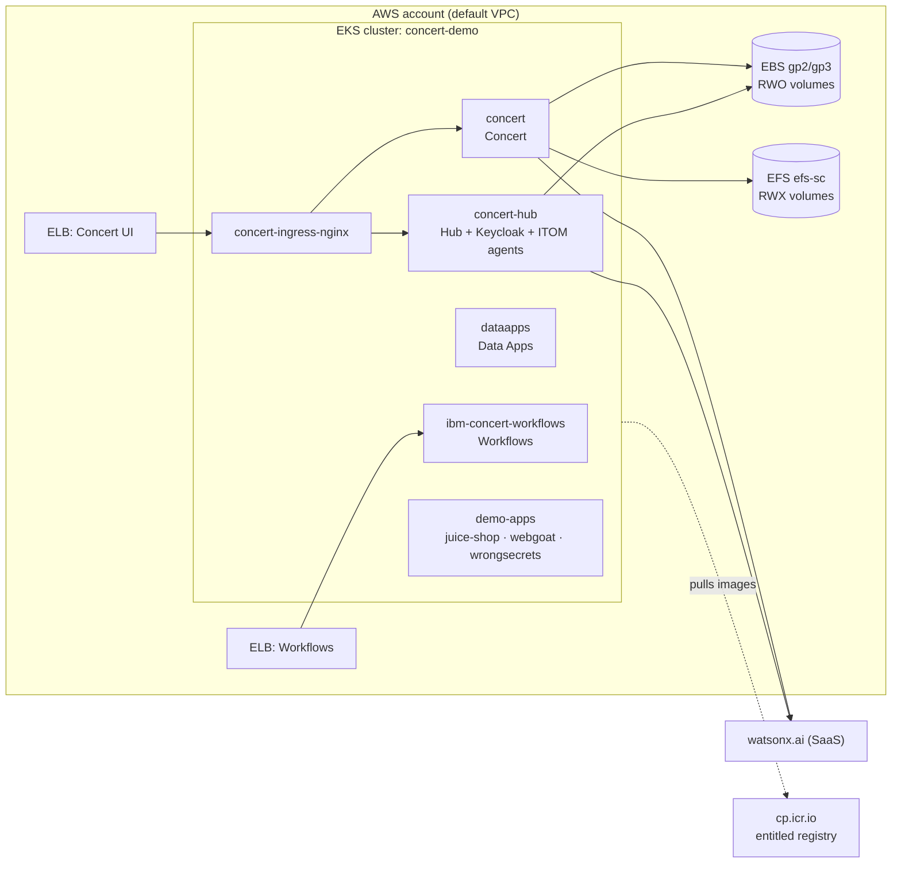
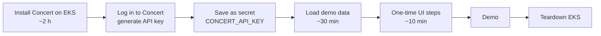

# IBM Concert 3.1.0 on Amazon EKS

Automated install of **IBM Concert v3.1.0** on a new Amazon EKS cluster. It covers the **Hub, Concert, Data Apps and
Workflows** components, with watsonx.ai enabled. It also loads demo data for an L3 demo, built from three real OWASP
apps (**Juice Shop, WebGoat and WrongSecrets**) running on the same cluster.

You can run it in two ways:
- **GitHub Actions pipeline.** Click *Run workflow* and wait about 2 hours. No laptop needs to stay open.
- **One local command,** `./run-all.sh`, from a Mac or Linux machine.

Secure Coder is not installed.

---

## Contents
- [What gets built](#what-gets-built)
- [Prerequisites](#prerequisites)
- [Option A: GitHub Actions pipeline](#option-a-github-actions-pipeline)
- [Option B: run locally](#option-b-run-locally)
- [After the install: one-time UI steps](#after-the-install-one-time-ui-steps)
- [Teardown](#teardown)
- [Repository layout](#repository-layout)
- [Configuration reference](#configuration-reference)
- [Troubleshooting and known issues](#troubleshooting-and-known-issues)

---

## What gets built



| Stage | Script | What it does | Time |
|---|---|---|---|
| 1. cluster | `scripts/00-create-cluster.sh`, `00b-create-efs.sh` | IAM roles, EKS control plane, add-ons (VPC CNI, CoreDNS, EBS CSI, EFS CSI, metrics-server), node group, EFS file system + `efs-sc` StorageClass | 25–35 min |
| 2. install | `scripts/01-install-in-cluster.sh` → `01-install-concert.sh` | Runs IBM's installer **as a Kubernetes Job inside the cluster** (Amazon Linux 2023). It survives laptop sleep and dropped CI connections; re-running re-attaches to the logs | 60–90 min |
| 3. post-install | `scripts/02-post-install.sh` | NGINX ingress, Concert + Keycloak routes, Keycloak SSO setup, watsonx credentials, Home menu, health checks | 10 min |
| 4. demo data | `demo-data/load-demo-data.sh all` | Deploys the 3 OWASP apps, runs Trivy (and Semgrep) scans, builds ConcertDef SBOMs and a certificate inventory, and uploads all of it to Concert | 20–30 min |

Default size: **3 × 16 vCPU / 32 GB nodes**, 512 GB disk, all in `us-east-1b`. The full install requests about 34 vCPU,
so 2 nodes are not enough. All nodes sit in one AZ because EBS volumes are zonal.

**Cost:** about USD 2–3 per hour on On-Demand nodes, plus the EKS control plane, ELBs and EFS. Tear it down when you're finished.

---

## Prerequisites

| Item | Where to get it |
|---|---|
| AWS account + IAM identity that can create EKS, EC2, EFS, ELB and IAM roles | AWS admin |
| IBM entitlement key | https://myibm.ibm.com/products-services/containerlibrary |
| watsonx.ai API key + project ID | IBM Cloud → watsonx.ai Runtime. Use the **Essentials** plan; the Lite plan's token quota runs out within an hour |
| Concert admin password | Choose one. It is used for the `admin` user |
| GitHub forks of `juice-shop`, `WebGoat`, `wrongsecrets` | Only needed for demo data and SAST. Default owner `vivek99singh` |

For local runs you also need `aws`, `kubectl`, `helm`, `docker` (colima on a Mac), `trivy`, `python3`, `curl` and bash 4+.
`semgrep` is optional.

---

## Option A: GitHub Actions pipeline

### 1. Add secrets and variables
**Settings → Secrets and variables → Actions**

| Secret | Required for | Notes |
|---|---|---|
| `AWS_ACCESS_KEY_ID` | all | Ideally a dedicated CI IAM user |
| `AWS_SECRET_ACCESS_KEY` | all | |
| `AWS_SESSION_TOKEN` | optional | Only for temporary credentials. They usually expire before a 2-hour install finishes |
| `IBM_ENTITLEMENT_KEY` | install | |
| `WATSONX_API_KEY` | install | |
| `WATSONX_API_PROJECT_ID` | install | |
| `CONCERT_ADMIN_PASSWORD` | install | |
| `CONCERT_API_KEY` | demo data | Generate it in the Concert UI **after** the install (see below) |

| Variable (optional) | Default | Notes |
|---|---|---|
| `EXTRA_ADMIN_ARNS` | none | Space-separated IAM ARNs given cluster-admin. **Add your own IAM user/role**; otherwise only the pipeline's identity can use `kubectl` |
| `WATSONX_API_URL` | `https://eu-gb.ml.cloud.ibm.com` | Region of your watsonx.ai instance |
| `DEMO_ALLOWED_CIDR` | runner's IP | Who can reach the demo app load balancers, e.g. `203.0.113.7/32` |
| `DEMO_GITHUB_USER` | `vivek99singh` | Owner of the OWASP app forks |
| `RUNNER_LABELS` | `"ubuntu-latest"` | JSON. For a self-hosted runner: `["self-hosted","linux","x64"]` |

With the GitHub CLI:
```bash
gh secret set IBM_ENTITLEMENT_KEY          # prompts for the value
gh secret set -f secrets.env               # or load several from a dotenv file
gh variable set EXTRA_ADMIN_ARNS --body "$(aws sts get-caller-identity --query Arn --output text)"
```

### 2. Run the workflows (Actions tab)

| Workflow | When | Inputs |
|---|---|---|
| **Install Concert on EKS** | First | `cluster`, `region`, `node_az`, `capacity_type` (ON_DEMAND / SPOT), `node_count`, `concert_version`, `start_from` (cluster / install / post-install) |
| **Load demo data** | After you have set `CONCERT_API_KEY` | `step` (all, deploy, scan, …), `allowed_cidr`, `cert_renewal` |
| **Teardown EKS** | When you're finished | `cluster`, `region`, `confirm` (type the cluster name) |
| **Lint** | Automatically on every push | none |

The install run ends with a summary that shows the **Concert and Workflows URLs**.



**If a stage fails:** fix the cause and re-run **Install** with `start_from` set to the failed stage. Every stage is
idempotent. If the runner dies during stage 2, the installer Job keeps running in the cluster, and `start_from=install` re-attaches to it.

> **Runners:** `ubuntu-latest` on github.com has everything the pipeline needs. Some GitHub Enterprise instances turn
> Actions off for personal repositories (github.ibm.com does). There, either move the repo to an org that has Actions
> and a runner, or use Option B.

---

## Option B: run locally

```bash
git clone <this repo> && cd <repo>
cp secrets.env.example secrets.env && chmod 600 secrets.env   # fill in the keys
./run-all.sh                     # cluster -> install -> post-install -> demo data (~2.5 h)
```

- `run-all.sh` records finished stages in `.run-state`. Running it again resumes after the last completed stage.
- `./run-all.sh --from install` re-runs from a given stage (`cluster | install | post-install | demo-data`).
- It pauses once, after the install, so you can paste the Concert API key, unless `CONCERT_API_KEY` is already in `secrets.env`.
- On a Mac it keeps the machine awake with `caffeinate`. Logs go to `logs/run-all-<time>.log`.
- Any stage can also be run on its own. Each script documents its env vars at the top:

```bash
export CLUSTER=concert-demo REGION=us-east-1 CAPACITY_TYPE=ON_DEMAND
./scripts/00-create-cluster.sh
./scripts/01-install-in-cluster.sh
./scripts/02-post-install.sh
(cd demo-data && ./load-demo-data.sh all)
```

---

## After the install: one-time UI steps

Open the Concert URL and choose **Log in with SSO**. Log in as user `admin` with `CONCERT_ADMIN_PASSWORD`, and accept the self-signed certificate warning.

1. **API key:** profile (top right) → **API key** → Generate. Save it as `CONCERT_API_KEY`, either as a secret for the pipeline
   or in `secrets.env` for local runs. The value shown is already in the `C_API_KEY` format the toolkit needs.
2. **Workflows → Authentications → Create:** name `concert-self`, service **IBM Hub - Self**. Discovery and AI workflows need it.
3. **Administration → Integrations → Connections → GitHub:** host `https://api.github.com/` and a fine-grained PAT that has
   Issues read/write access on the forks. Enable **Issues** on the `juice-shop` fork, because forks have Issues off by default.
4. Check that **Ask watsonx** answers.
5. Wait about 15 minutes for ingestion (**Integrations → Ingestion jobs**).
6. Optional: import `workflows/Renew_EKS_TLS_Certificate.yaml` into Workflows to demo certificate renewal (run `scripts/05-cert-renewal-setup.sh` first).

---

## Teardown

Run the **Teardown EKS** workflow, or locally:
```bash
./scripts/99-teardown.sh          # asks you to type the cluster name
```
The script works in an order that avoids orphaned resources:
1. Deletes the LoadBalancer services, so Kubernetes removes their ELBs.
2. Deletes the node group, then the cluster.
3. Deletes the EFS mount targets and file system, the EFS security group, and leftover tagged EBS volumes.

IAM roles are kept, because they are free and reused on the next build. Check **EC2 → Security groups** for the two `k8s-elb-*` groups; they sometimes need deleting by hand.

---

## Repository layout

```
.
├── .github/
│   ├── actions/setup/action.yml      # installs aws/kubectl/helm(/trivy/semgrep), AWS creds, kubeconfig
│   └── workflows/
│       ├── install.yml               # Install Concert on EKS (stages 1-3)
│       ├── demo-data.yml             # Load demo data (stage 4)
│       ├── teardown.yml              # Teardown EKS
│       └── lint.yml                  # bash -n / py_compile / shellcheck on push
├── run-all.sh                        # local end-to-end runner (resumable)
├── params.ini                        # Concert installer params (placeholders filled at install time)
├── secrets.env.example               # template for secrets.env (gitignored)
├── scripts/
│   ├── 00-create-cluster.sh          # IAM roles, EKS, add-ons, node group
│   ├── 00b-create-efs.sh             # EFS + efs-sc StorageClass (RWX for roja-buddy)
│   ├── 01-install-in-cluster.sh      # wraps the installer in a Kubernetes Job (+ PDB)
│   ├── 01-install-concert.sh         # downloads the 3.1.0 package, fills params.ini, runs setup
│   ├── 02-post-install.sh            # ingress, Keycloak SSO, watsonx, health checks
│   ├── 03-fill-resilience-metrics.py # fills in resilience assessment metrics through the API
│   ├── 05-cert-renewal-setup.sh      # cluster RBAC/secrets for the certificate renewal workflow
│   ├── cert-renewal/renew.sh         # script the renewal Job runs
│   └── 99-teardown.sh                # deletes everything that costs money
├── demo-data/
│   ├── demo-apps.yaml                # juice-shop / webgoat / wrongsecrets deployments + LBs
│   ├── load-demo-data.sh             # deploy, scan, sbom, certs, upload (see ./load-demo-data.sh)
│   └── make-deploy-sboms.py          # ConcertDef 1.0.2 deploy SBOMs
└── workflows/
    └── Renew_EKS_TLS_Certificate.yaml # Concert Workflows definition (import in the Workflows UI)
```

IBM's Hub and ITOM helper scripts (`setup-keycloak.sh` and others) are **not** stored here. `02-post-install.sh`
downloads them from the public release `github.com/IBM/Concert/releases/download/<version>/ibm-concert-x86.tar.gz` and
caches them in `~/.cache/ibm-concert-<version>`.

---

## Configuration reference

Environment variables read by the scripts (all optional unless noted):

| Variable | Default | Used by |
|---|---|---|
| `CLUSTER` / `REGION` | `concert-demo` / `us-east-1` | all |
| `NODE_AZ` | `us-east-1b` | cluster, EFS |
| `NODE_COUNT` | `3` | cluster |
| `CAPACITY_TYPE` | `SPOT` locally, `ON_DEMAND` in the pipeline | cluster |
| `NODE_TYPES` | seven 16 vCPU types (`c5.4xlarge m6i.4xlarge …`) | cluster |
| `NODE_DISK_GB` | `512` | cluster |
| `K8S_VERSION` | EKS default version | cluster |
| `EXTRA_ADMIN_ARNS` | none | cluster: extra EKS access entries with cluster-admin |
| `IBM_ENTITLEMENT_KEY`, `WATSONX_API_KEY`, `WATSONX_API_PROJECT_ID`, `CONCERT_ADMIN_PASSWORD` | **required** | install, post-install |
| `WATSONX_API_URL` | `https://eu-gb.ml.cloud.ibm.com` | install, post-install |
| `CONCERT_VERSION` | `v3.1.0` | install, post-install |
| `CONCERT_API_KEY` | **required** for upload | demo data, cert renewal |
| `DEMO_ALLOWED_CIDR` | caller's public IP `/32` | demo data |
| `GITHUB_USER` | `vivek99singh` | demo data (fork owner) |
| `CONFIRM_CLUSTER` | none (prompts) | teardown, non-interactive |

The Concert installer itself is configured in `params.ini`: namespaces, scale level, storage classes, `ENABLE_AI` and
`ENABLE_CROSS_PRODUCT_INTEGRATION=true`.

---

## Troubleshooting and known issues

These were found on the first real 3.1.0 install, and the fixes are already in the scripts:

| Symptom | Cause / fix |
|---|---|
| `roja-buddy exceeded its progress deadline` | roja-buddy (new in 3.1) needs **ReadWriteMany** volumes, which EBS can't provide. Fixed with EFS + `FILE_STORAGE_CLASS_CONCERT=efs-sc` |
| Pods stuck `Pending` (CPU) | The full install requests about 34 vCPU, so use 3 nodes of 16 vCPU |
| Install killed halfway on Spot | Spot rebalances drained the installer. The Job now has a PDB; use `ON_DEMAND` for demos |
| Home / AI gateway menus missing | ITOM needs `jq` in the installer. The Job installs it, and post-install re-applies the menu |
| Concert URL returns **503** | The ingress must target `ibm-concert-solis-gw-svc:11443`, not `ibm-concert-external-gw-svc` |
| SAST/SBOM upload returns **413** | The ingress needs `proxy-body-size: 0` |
| Login: *OIDC client credentials could not be loaded* | Route `/sys/internal/kc` to `ibm-solis-hub-gw-svc:11443`, then run `setup-keycloak.sh` (post-install does both) |
| *watsonx isn't connected* | `ENABLE_AI` didn't write the credentials. Post-install patches `app-cfg-secret` (concert) and creates `itom-external-secrets` (concert-hub) |
| watsonx `403 token_quota_reached` | The Lite plan is used up by the Hub agents. Switch to Essentials |
| Workflows Kubernetes blocks return **401** | The authentication `apiKey` must be the raw service-account token, **without** a `Bearer ` prefix |
| Renew dialog: *no trackable workflow ID was returned* | Expose renewal workflows with **Asynchronous execution**. Keep `Certificate_Flow_Orchestrator` synchronous |
| Vulnerability page "Open ticket": *object_id cannot be empty* | Open tickets from Inventory → Applications → app → version → CVE findings → **+ Open ticket** instead |
| Toolkit upload `CNCRTRCOVAL10187E` | Pin `ibm-concert-toolkit:v3.1.0`. The newer toolkit writes ConcertDef 2.0.0, which 3.1.0 rejects |

Useful commands:
```bash
kubectl get pods -A | grep -Ev 'Running|Completed'          # anything unhealthy
kubectl logs job/concert-install -n concert-installer --tail=100   # failed installer
kubectl get pvc -A | grep -v Bound                          # storage problems
```

Still open on 3.1.0: CVE findings don't link to environments or deployments, so the risk score equals the CVSS score.

