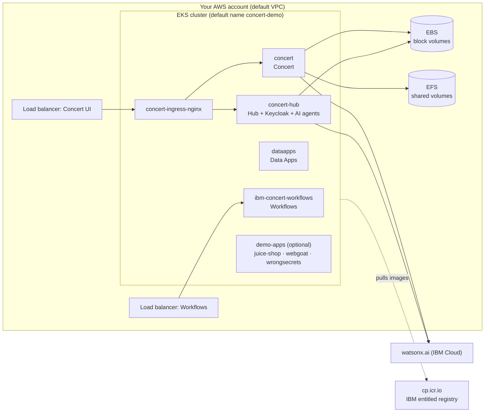
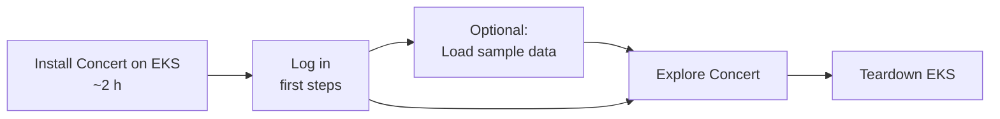

# IBM Concert on Amazon EKS

Scripts and a GitHub Actions pipeline that build a working **IBM Concert v3.1.0** environment on a new **Amazon EKS**
cluster, from an empty AWS account to a logged-in Concert UI in about 2 hours. This is for anyone who wants to explore
Concert on Kubernetes without working out the install by hand.

**IBM Concert** is IBM's AI-powered platform for application risk and resilience. It brings together an application's
vulnerabilities (CVEs and SAST findings), software composition (SBOMs), certificates, compliance posture and resilience
scores, and uses watsonx.ai to explain issues and generate remediation workflows.

What you get:
- **Concert, Hub, Data Apps and Concert Workflows** (everything except Secure Coder), with **watsonx.ai** turned on
- **Single sign-on** through Hub's built-in Keycloak, behind an NGINX ingress and AWS load balancers
- **Optional sample data:** three intentionally vulnerable open-source apps (OWASP Juice Shop, WebGoat and WrongSecrets)
  deployed on the same cluster, scanned and uploaded, so Concert isn't empty when you log in
- **One-click teardown**, so the cluster only costs money while you use it

IBM documents Concert on Kubernetes in general terms. On EKS, a plain install fails in several places: storage,
ingress, SSO and the AI configuration. Every fix we needed is built into these scripts and listed under
[Troubleshooting](#troubleshooting-and-known-issues).

---

## Contents
- [Quick start](#quick-start)
- [What gets built](#what-gets-built)
- [Prerequisites](#prerequisites)
- [Option A: GitHub Actions pipeline](#option-a-github-actions-pipeline)
- [Option B: run from your machine](#option-b-run-from-your-machine)
- [Check the install](#check-the-install)
- [First steps in Concert](#first-steps-in-concert)
- [Optional: sample data](#optional-sample-data)
- [Optional: resilience and certificate renewal](#optional-resilience-and-certificate-renewal)
- [Teardown](#teardown)
- [Repository layout](#repository-layout)
- [Configuration reference](#configuration-reference)
- [Troubleshooting and known issues](#troubleshooting-and-known-issues)

---

## Quick start

1. Get the [prerequisites](#prerequisites): an AWS account, an IBM entitlement key and a watsonx.ai API key.
2. **Fork or import this repo** into your own GitHub account and add the [secrets](#1-add-secrets-and-variables).
3. **Actions → Install Concert on EKS → Run workflow.** Wait about 2 hours. The run summary shows the Concert URL.
4. Open the URL, choose **Log in with SSO**, and log in as `admin` with the password you set.
5. When you're done, run **Actions → Teardown EKS**.

No GitHub Actions? Clone the repo, fill in `secrets.env` and run `./run-all.sh` ([Option B](#option-b-run-from-your-machine)).

---

## What gets built



The build runs in four stages. Each one is safe to re-run.

| Stage | Script | What it does | Time |
|---|---|---|---|
| 1. cluster | `scripts/00-create-cluster.sh`, `00b-create-efs.sh` | IAM roles, EKS control plane, add-ons (VPC CNI, CoreDNS, EBS CSI, EFS CSI, metrics-server), node group, EFS file system + `efs-sc` StorageClass | 25–35 min |
| 2. install | `scripts/01-install-in-cluster.sh` → `01-install-concert.sh` | Downloads IBM's Concert 3.1.0 installer and runs it **as a Kubernetes Job inside the cluster** | 60–90 min |
| 3. post-install | `scripts/02-post-install.sh` | NGINX ingress, Concert and Keycloak routes, SSO setup, watsonx credentials, health checks | 10 min |
| 4. sample data (optional) | `demo-data/load-demo-data.sh all` | Deploys the 3 OWASP apps, scans them with Trivy (and Semgrep), builds SBOMs and a certificate inventory, and uploads it all to Concert | 20–30 min |

**Why the installer runs inside the cluster:** IBM's installer needs Linux and runs for over an hour. Running it as a
Job means a laptop going to sleep, or a CI runner dropping, doesn't kill the install. Re-running stage 2 re-attaches to the Job's logs.

**Size and cost:** 3 nodes with 16 vCPU / 32 GB each, 512 GB disks, in one Availability Zone. The install requests about
34 vCPU, so 2 nodes are not enough. The nodes share one AZ because EBS volumes are zonal. Expect roughly
**USD 2.5–3.5 per hour** On-Demand (3 × c5.4xlarge, the EKS control plane, 2–5 load balancers and EFS). Tear it down when you're finished.

---

## Prerequisites

| You need | Details |
|---|---|
| **AWS account** | A sandbox account where you can create EKS clusters. It must still have its **default VPC** with default subnets, because the cluster uses them |
| **AWS permissions** | Simplest: `AdministratorAccess` in a sandbox account. Otherwise: full access to EKS, EC2 (instances, volumes, security groups), EFS and Elastic Load Balancing, plus IAM `CreateRole`, `AttachRolePolicy`, `UpdateAssumeRolePolicy`, `GetRole` and `PassRole` |
| **AWS quota** | At least 48 On-Demand vCPUs for standard instances in the region (the default quota is often 32; ask AWS for more if needed) |
| **IBM entitlement key** | Gives access to Concert's container images. Get it from https://myibm.ibm.com/products-services/containerlibrary (needs a Concert entitlement or trial) |
| **watsonx.ai** | An IBM Cloud API key and a watsonx.ai project ID. Use the **Essentials** plan: the Lite plan's token quota runs out within an hour, because the Hub AI agents use it heavily |
| **Admin password** | Any password you choose for Concert's `admin` user |

The defaults are region `us-east-1` and AZ `us-east-1b`. **If you change the region, change the AZ too**, to one in that region (`node_az` / `NODE_AZ`).

---

## Option A: GitHub Actions pipeline

### 1. Add secrets and variables
In your copy of the repo: **Settings → Secrets and variables → Actions**.

| Secret | Required for | Notes |
|---|---|---|
| `AWS_ACCESS_KEY_ID` | all | A dedicated IAM user for CI is best |
| `AWS_SECRET_ACCESS_KEY` | all | |
| `AWS_SESSION_TOKEN` | optional | Only for temporary credentials. They usually expire before a 2-hour install finishes, so long-lived keys are easier |
| `IBM_ENTITLEMENT_KEY` | install | |
| `WATSONX_API_KEY` | install | |
| `WATSONX_API_PROJECT_ID` | install | |
| `CONCERT_ADMIN_PASSWORD` | install | |
| `CONCERT_API_KEY` | sample data | Create it in the Concert UI **after** the install (see [First steps](#first-steps-in-concert)) |

| Variable (optional) | Default | Notes |
|---|---|---|
| `EXTRA_ADMIN_ARNS` | none | Space-separated IAM user/role ARNs that get cluster-admin. **Add your own**: otherwise only the pipeline's AWS identity can use `kubectl` on the cluster |
| `WATSONX_API_URL` | `https://eu-gb.ml.cloud.ibm.com` | The region of your watsonx.ai instance, e.g. `https://us-south.ml.cloud.ibm.com` |
| `DEMO_ALLOWED_CIDR` | the runner's IP | Who can open the sample apps, e.g. your IP: `203.0.113.7/32` |
| `DEMO_GITHUB_USER` | `vivek99singh` | GitHub account that holds your forks of the sample apps (see [sample data](#optional-sample-data)) |
| `RUNNER_LABELS` | `"ubuntu-latest"` | JSON. For a self-hosted runner: `["self-hosted","linux","x64"]` |

With the GitHub CLI, from a filled-in `secrets.env`:
```bash
set -a; source secrets.env; set +a
for s in IBM_ENTITLEMENT_KEY WATSONX_API_KEY WATSONX_API_PROJECT_ID CONCERT_ADMIN_PASSWORD; do
  printf '%s' "${!s}" | gh secret set "$s"
done
gh secret set AWS_ACCESS_KEY_ID          # prompts for the value
gh secret set AWS_SECRET_ACCESS_KEY
gh variable set EXTRA_ADMIN_ARNS --body "$(aws sts get-caller-identity --query Arn --output text)"
```

### 2. Run the workflows (Actions tab)

| Workflow | When | Inputs |
|---|---|---|
| **Install Concert on EKS** | First | `cluster`, `region`, `node_az`, `capacity_type` (ON_DEMAND / SPOT), `node_count`, `concert_version`, `start_from` (cluster / install / post-install) |
| **Load sample data** | Optional, after you set `CONCERT_API_KEY` | `step` (all, deploy, scan, …), `allowed_cidr`, `cert_renewal` |
| **Teardown EKS** | When you're finished | `cluster`, `region`, `confirm` (type the cluster name) |
| **Lint** | Automatically on every push | none |



**If a stage fails:** fix the cause and re-run **Install** with `start_from` set to the failed stage. If the runner
stops during stage 2, the install keeps running in the cluster, and `start_from=install` picks it up again.

> **Runners:** GitHub's `ubuntu-latest` runners on github.com have everything the pipeline needs. Some GitHub
> Enterprise servers turn Actions off for personal repositories; github.ibm.com is one. There, move the repo to an org
> that has Actions and a runner, or use Option B.

---

## Option B: run from your machine

You need macOS or Linux with `aws` (logged in), `kubectl`, `helm`, `python3`, `curl` and bash 4 or later. The sample
data also needs `docker` (colima on a Mac) and `trivy`; `semgrep` is optional.

```bash
git clone <this repo> && cd <repo>
cp secrets.env.example secrets.env && chmod 600 secrets.env   # fill in the keys
./run-all.sh                     # cluster -> install -> post-install -> sample data (~2.5 h)
```

- The script records finished stages in `.run-state`, so running it again resumes where it stopped.
  `./run-all.sh --from install` re-runs from a given stage (`cluster | install | post-install | demo-data`).
- It pauses once after the install so you can paste a Concert API key for the sample data, unless `CONCERT_API_KEY` is already in `secrets.env`.
- On a Mac it keeps the machine awake. Logs go to `logs/run-all-<time>.log`.
- To run stages one at a time (each script lists its settings at the top):

```bash
export CLUSTER=concert-demo REGION=us-east-1 CAPACITY_TYPE=ON_DEMAND
./scripts/00-create-cluster.sh
./scripts/01-install-in-cluster.sh
./scripts/02-post-install.sh
(cd demo-data && ./load-demo-data.sh all)     # optional sample data
```

The local default is `CAPACITY_TYPE=SPOT`, which is cheaper but can interrupt the install. Use `ON_DEMAND` unless you're trying to save money.

---

## Check the install

At the end, `02-post-install.sh` prints a health report. A good install shows:
- `Pods not Running/Completed`: **none**, and **all PVCs Bound**
- product registration lists **concert**, **dataapps** and **workflows**, with no `WARN` lines
- the **Concert** and **Workflows** URLs

You can check again at any time:
```bash
aws eks update-kubeconfig --name concert-demo --region us-east-1
kubectl get pods -A | grep -Ev 'Running|Completed'      # should print only the header
```

Open the Concert URL. The load balancer's DNS name can take 2–5 minutes to resolve. Accept the self-signed certificate
warning, choose **Log in with SSO**, and log in as `admin` with `CONCERT_ADMIN_PASSWORD`. You should land on the Concert home page.

---

## First steps in Concert

1. **Create an API key:** profile icon (top right) → **API key** → Generate. Keep it; it's needed for any upload (the
   sample data, the toolkit, the API). The value shown is already in the right format.
2. **Check watsonx:** open **Ask watsonx** and ask a question. If it says watsonx isn't connected, see Troubleshooting.
3. **Connect Workflows to Concert:** **Workflows → Authentications → Create**, name `concert-self`, service
   **IBM Hub - Self**. Discovery and AI workflows need it.
4. **Optional, opening GitHub issues from findings:** **Administration → Integrations → Connections → GitHub**. Use host
   `https://api.github.com/` and a fine-grained personal access token with Issues read/write on your repos.

---

## Optional: sample data

A new Concert install is empty. The sample data gives you something real to look at: three open-source apps that are
vulnerable on purpose, so the vulnerability, SBOM, certificate and risk views are full.

1. **Fork** [juice-shop](https://github.com/juice-shop/juice-shop), [WebGoat](https://github.com/WebGoat/WebGoat) and
   [wrongsecrets](https://github.com/OWASP/wrongsecrets) into your GitHub account. Set `DEMO_GITHUB_USER` (pipeline) or
   `GITHUB_USER` (local) to that account. Concert links findings to these repos.
2. Save the Concert API key as `CONCERT_API_KEY`.
3. Run **Actions → Load sample data**, or locally `cd demo-data && ./load-demo-data.sh all`.

This deploys the apps to namespace `demo-apps`. Their load balancers only accept `DEMO_ALLOWED_CIDR`, so the
vulnerable apps aren't open to the internet. It then uploads to Concert:
- application definitions
- Trivy image scans (CVEs)
- Semgrep SAST results, if semgrep is installed
- a certificate inventory, including one expired and two expiring certificates

Allow about 15 minutes for Concert to process the uploads (**Administration → Integrations → Ingestion jobs**). Then
expand the left sidebar and look at **Dimensions → Vulnerability**, **Dimensions → Software composition**,
**Dimensions → Operations** (Certificates tab) and **Inventory → Applications**.

Individual steps can be re-run: `./load-demo-data.sh` with no argument lists them (deploy, scan, sbom, certs, upload, compliance, …).

---

## Optional: resilience and certificate renewal

These need the sample apps and take some UI work. They show Concert's resilience scoring and its Workflows automation.

### Kubernetes access for Concert
```bash
./scripts/04-concert-k8s-access.sh
```
This creates a **read-only** service account for Concert's discovery, and a service account for Workflows that is
**limited to `demo-apps`**. It writes the endpoint and tokens to `discovery-connection/`, which git ignores.

### Resilience scores
1. **Administration → Integrations → Connections → Create connection → Kubernetes**, not "Amazon EKS", which asks for AWS
   keys. Endpoint: `discovery-connection/api-server-url.txt`. Token: `discovery-connection/token.txt`.
2. **Resilience → Discover your data:**
   - Kubernetes, your connection, cluster name `concert-demo`.
   - Inventory: target environment `production-eks`, aggregation 1 hour, namespace `demo-apps`.
   - Turn on **application grouping** by label `app`, which gives 3 applications. Map each to the existing app
     (Juice Shop, WebGoat or WrongSecrets) with the **Autodiscovery Profile** and a new version, e.g. `1.1.0`.
3. Discovery takes about 10 minutes and creates the deployments and first assessments. It collects only some of the
   metrics the profile needs, so fill in the rest:
   ```bash
   CONCERT_URL=https://<concert-host> CONCERT_API_KEY=<key> ./scripts/03-fill-resilience-metrics.py
   ```
   Hourly re-assessments only reuse the discovered metrics, so run this again before you show the scores.

### Certificate renewal from Concert
1. Run `./scripts/05-cert-renewal-setup.sh`. It needs `CONCERT_API_KEY`; the **Load sample data** workflow runs it by default.
2. **Workflows → Authentications → Create:** service **Kubernetes**, name `eks-demo-apps`, protocol `https://`.
   Host: the API endpoint without `https://`. API key: `discovery-connection/workflows-token.txt`, pasted as is, with
   **no** `Bearer ` prefix.
3. Import `workflows/Renew_EKS_TLS_Certificate.yaml` and expose it with **Asynchronous execution**.
4. Expose the `Certificate_Flow_Orchestrator` library workflow (synchronous) and register the renewal flow for the
   source name `EKS TLS secret`. After that, the **Renew** button on a certificate in Concert runs it.

Run the workflow with `dry_run=true` first. That only checks the cluster connection.

---

## Teardown

Run **Actions → Teardown EKS**, or locally:
```bash
./scripts/99-teardown.sh          # asks you to type the cluster name
```
The script deletes things in an order that avoids leftover, still-billing resources:
1. The load balancer services, so Kubernetes removes their AWS load balancers.
2. The node group, then the cluster.
3. The EFS file system and its security group, and any leftover EBS volumes.

IAM roles are kept: they're free, and the next build reuses them. Afterwards, check **EC2 → Security groups** for two
`k8s-elb-*` groups; these sometimes have to be deleted by hand.

---

## Repository layout

```
.
├── .github/
│   ├── actions/setup/action.yml      # installs aws/kubectl/helm (+trivy/semgrep), AWS creds, kubeconfig
│   └── workflows/
│       ├── install.yml               # Install Concert on EKS (stages 1-3)
│       ├── demo-data.yml             # Load sample data (stage 4)
│       ├── teardown.yml              # Teardown EKS
│       └── lint.yml                  # syntax checks on every push
├── run-all.sh                        # local end-to-end runner (resumable)
├── params.ini                        # settings for IBM's installer (placeholders filled at install time)
├── secrets.env.example               # template for secrets.env (git-ignored)
├── scripts/
│   ├── 00-create-cluster.sh          # IAM roles, EKS, add-ons, node group
│   ├── 00b-create-efs.sh             # EFS + efs-sc StorageClass (shared volumes Concert 3.1 needs)
│   ├── 01-install-in-cluster.sh      # runs the installer as a Kubernetes Job
│   ├── 01-install-concert.sh         # downloads the Concert package, fills params.ini, runs IBM's setup
│   ├── 02-post-install.sh            # ingress, SSO, watsonx, health checks
│   ├── 03-fill-resilience-metrics.py # optional: completes resilience assessments through the API
│   ├── 04-concert-k8s-access.sh      # optional: service accounts for Concert discovery and Workflows
│   ├── 05-cert-renewal-setup.sh      # optional: cluster side of the certificate renewal workflow
│   ├── cert-renewal/renew.sh         # the script the renewal Job runs
│   └── 99-teardown.sh                # deletes everything that costs money
├── demo-data/                        # optional sample data
│   ├── demo-apps.yaml                # juice-shop / webgoat / wrongsecrets deployments + load balancers
│   ├── load-demo-data.sh             # deploy, scan, sbom, certs, upload
│   └── make-deploy-sboms.py          # deployment SBOMs (environment and access points)
└── workflows/
    └── Renew_EKS_TLS_Certificate.yaml # Concert Workflows definition (import in the Workflows UI)
```

IBM's own helper scripts, such as `setup-keycloak.sh`, are **not** copied into this repo. `02-post-install.sh` downloads
them from IBM's public release (`github.com/IBM/Concert/releases`) and caches them in `~/.cache/ibm-concert-<version>`.

---

## Configuration reference

Environment variables the scripts read (all optional unless marked required):

| Variable | Default | Used by |
|---|---|---|
| `CLUSTER` / `REGION` | `concert-demo` / `us-east-1` | all |
| `NODE_AZ` | `us-east-1b` | cluster, EFS (must be in `REGION`) |
| `NODE_COUNT` | `3` | cluster |
| `CAPACITY_TYPE` | `SPOT` locally, `ON_DEMAND` in the pipeline | cluster |
| `NODE_TYPES` | seven 16 vCPU types (`c5.4xlarge m6i.4xlarge …`) | cluster |
| `NODE_DISK_GB` | `512` | cluster |
| `K8S_VERSION` | EKS default version | cluster |
| `EXTRA_ADMIN_ARNS` | none | cluster: extra IAM principals with cluster-admin |
| `IBM_ENTITLEMENT_KEY`, `WATSONX_API_KEY`, `WATSONX_API_PROJECT_ID`, `CONCERT_ADMIN_PASSWORD` | **required** | install, post-install |
| `WATSONX_API_URL` | `https://eu-gb.ml.cloud.ibm.com` | install, post-install |
| `CONCERT_VERSION` | `v3.1.0` | install, post-install |
| `CONCERT_API_KEY` | **required** for uploads | sample data, certificate renewal |
| `DEMO_ALLOWED_CIDR` | your public IP `/32` | sample data |
| `GITHUB_USER` | `vivek99singh` | sample data (owner of the forks) |
| `CONFIRM_CLUSTER` | none (prompts) | teardown without a prompt |

IBM's installer is configured in `params.ini`: namespaces, scale level, storage classes and AI settings. The defaults work as they are.

---

## Troubleshooting and known issues

These all came up during real installs of 3.1.0 on EKS. The fixes are already in the scripts; the table helps if you change something:

| Symptom | Cause / fix |
|---|---|
| `roja-buddy exceeded its progress deadline` | roja-buddy, new in 3.1, needs **ReadWriteMany** volumes, which EBS can't provide. Fixed with EFS (`FILE_STORAGE_CLASS_CONCERT=efs-sc`) |
| Pods stuck `Pending` (CPU) | The install requests about 34 vCPU. Use 3 nodes of 16 vCPU |
| Node group fails to create | Usually the vCPU quota. Check **Service Quotas → EC2 → Running On-Demand Standard instances** |
| Install killed halfway on Spot | A Spot reclaim drained the installer. Use `ON_DEMAND` |
| Home or AI gateway menus missing | Post-install re-applies them; re-run `02-post-install.sh` |
| Concert URL returns **503** | The ingress must point at `ibm-concert-solis-gw-svc:11443`, not `ibm-concert-external-gw-svc` |
| Uploads return **413** | The ingress needs `proxy-body-size: 0` |
| Login: *OIDC client credentials could not be loaded* | Keycloak isn't routed. Post-install routes `/sys/internal/kc` to the Hub gateway and runs `setup-keycloak.sh`; re-run it |
| *watsonx isn't connected* | Post-install writes the watsonx credentials to `app-cfg-secret` (namespace `concert`) and `itom-external-secrets` (namespace `concert-hub`). Check `WATSONX_*` and re-run it |
| watsonx `403 token_quota_reached` | The Lite plan is used up. Move to Essentials |
| Workflows Kubernetes steps return **401** | The authentication's API key must be the raw token, **without** `Bearer ` |
| Renew dialog: *no trackable workflow ID was returned* | Expose renewal workflows with **Asynchronous execution** |
| "Open ticket" on **Dimensions → Vulnerability**: *object_id cannot be empty* | Open tickets from **Inventory → Applications → app → version → CVE findings** instead |
| Upload error `CNCRTRCOVAL10187E` | The toolkit version must match the server. The scripts pin `ibm-concert-toolkit:v3.1.0` |

Useful commands:
```bash
kubectl get pods -A | grep -Ev 'Running|Completed'                  # anything unhealthy
kubectl logs job/concert-install -n concert-installer --tail=100    # why the installer failed
kubectl get pvc -A | grep -v Bound                                  # storage problems
```

Known limitation in 3.1.0: CVE findings aren't linked to environments or deployments, so an application's risk score equals the CVSS score.

Official documentation: [IBM Concert 3.1 docs](https://www.ibm.com/docs/en/concert/3.1.x).
